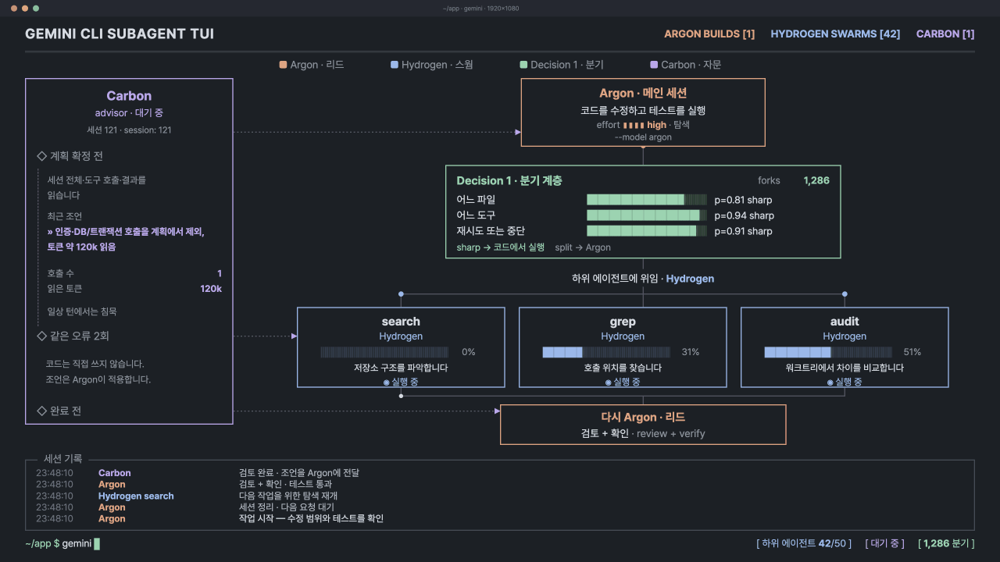

# Carbon 자문 키트 (Antigravity CLI용)

Argon(리드), Hydrogen(하위 에이전트), Carbon(자문), Decision 1(분기) 구성에서 세 가지 자문 시점을
실제 Antigravity CLI(`agy`)에서 동작하게 만드는 초안입니다.
훅이 시점을 잡아 리드 에이전트에게 자문 호출을 안내하고, 같은 내용을 대시보드가 읽는 JSONL 이벤트로 기록합니다.



위 화면은 [`docs/gemini_sub.html`](docs/gemini_sub.html)을 한 바퀴(40초) 녹화한 것입니다.
이 키트가 구현하려는 흐름을 보여 주는 개념 화면이며, 숫자와 로그는 실제 세션 데이터가 아니라 예시 값입니다.
직접 움직이는 화면을 보려면 이 파일을 내려받아 브라우저로 여세요.

- 확인한 환경: `agy` 1.5.9, macOS, bash 3.2, jq 1.7.1
- 상태: 자동 테스트는 통과했지만 실제 `agy` 세션에서는 아직 검증하지 않았습니다. 아래 "확인이 필요한 것"을 먼저 보세요.
- 전역 설정은 건드리지 않습니다. 모든 파일은 워크스페이스의 `.agents/` 아래에 들어갑니다.

## 구성

| 파일 | 설치 위치 | 역할 |
|---|---|---|
| `agents/carbon-advisor/agent.md` | `.agents/agents/carbon-advisor/agent.md` | 읽기 전용 자문 서브에이전트 |
| `hooks/hooks.json` | `.agents/hooks.json` | 훅 등록 (항목 이름 `advisor-kit`) |
| `hooks/advisor-hook.sh` | `.agents/advisor-kit/advisor-hook.sh` | 다섯 이벤트를 처리하는 훅 스크립트 |
| `hooks/advisor.conf` | `.agents/advisor-kit/advisor.conf` | 설정 |
| `statusline/statusline.sh` | `.agents/advisor-kit/statusline.sh` | 상태줄 스크립트 |
| `install.sh` | - | 설치, 제거 |
| `test/run-tests.sh` | - | 자동 테스트 86개 (agy를 실행하지 않음) |
| `test/demo-scenario.sh` | - | 한 세션 분량의 이벤트 파일을 만들어 대시보드에서 미리 보기 |
| `docs/gemini_sub.html` | - | 개념 화면 (브라우저로 열면 움직입니다) |
| `docs/demo.gif` | - | 위 화면을 녹화한 GIF |

## 설치

```bash
cd <이 폴더>
./install.sh --workspace <워크스페이스 폴더>
```

기존 `.agents/hooks.json`이 있으면 백업한 뒤 `advisor-kit` 항목만 추가합니다. 제거는 `./install.sh --uninstall --workspace <폴더>`입니다.

설치하면 그 폴더에서 새로 시작하는 `agy` 세션부터 훅이 동작합니다. 진행 중인 작업이 있으면 끝난 뒤에 설치하세요.
첫 파일 수정을 한 번 막고, 종료 직전에 한 번 더 일을 시키기 때문입니다.

## 동작 방식

| 화면의 트리거 | 잡는 방법 | 리드에게 하는 일 |
|---|---|---|
| 계획 확정 전 | `PreToolUse` (파일 쓰기 도구 3종). 사용자 요청당 첫 수정 | `deny`와 안내문을 한 번 반환. 리드는 자문을 받거나, 단순 수정이면 그대로 다시 실행 |
| 같은 오류 2회 | `PostToolUse`에서 같은 도구, 같은 대상, 같은 오류 문자열을 연속으로 센다 | 다음 `PreInvocation`에서 시스템 메시지를 주입 |
| 완료 전 | `Stop` (정상 종료이고, 이번 요청에서 파일을 수정했고, 수정 뒤 자문이 없을 때) | `continue`와 안내문을 반환 |

설계에서 지킨 것:

- **훅 안에서 자문 모델을 돌리지 않습니다.** 훅 기본 제한 시간이 30초라서, 훅은 리드에게 `invoke_subagent`로 `carbon-advisor`를 부르라고 안내만 합니다.
- **파일을 수정하지 않는 요청에서는 아무것도 하지 않습니다.** "일상 턴에서는 침묵"에 해당합니다.
- **반복하지 않습니다.** 계획 안내는 요청당 1회, 완료 전 검토는 요청당 최대 2회입니다.
- **실패하면 통과시킵니다.** 스크립트 오류, 깨진 입력, API 실패 모두 기본 동작(`allow` 또는 `{}`)으로 돌아갑니다.
- **리드 세션에만 겁니다.** 훅 입력의 `modelName`이 `argon`에 맞을 때만 동작하므로 Hydrogen 하위 에이전트와 Carbon 자문 세션은 통과합니다.

자문에게는 대화 기록 전체가 아니라 최근 256KB 사본(`.agents/advisor-kit/state/transcript-tail-*.jsonl`)의 경로를 넘깁니다.
서브에이전트는 부모의 대화 기록을 물려받지 않기 때문이고, 크기를 제한해 자문이 읽는 토큰을 줄이기 위해서입니다.

## Decision 1 연결 (선택)

키가 없으면 위 규칙만으로 동작합니다. 키가 있으면 두 곳에서 예/아니오 질문 하나씩을 보냅니다.

- 계획 확정 전: "수정 전에 선임 검토가 필요한 변경인가"
- 완료 전: "완료 선언 전에 독립 검토가 필요한가"

```bash
mkdir -p ~/.config/advisor-kit
printf '%s' '<Gemini API 키>' > ~/.config/advisor-kit/decisions.key
chmod 600 ~/.config/advisor-kit/decisions.key
```

| 판정 | 조건 | 동작 |
|---|---|---|
| sharp, 필요 | 확신도 0.70 이상, 예 확률 0.5 이상 | 자문을 받으라고 안내 |
| sharp, 불필요 | 확신도 0.70 이상, 예 확률 0.5 미만 | 조용히 통과 |
| split | 확신도 0.70 미만 | 판정이 갈렸다고 알리고 리드가 판단 |
| 응답 없음 | 키 없음, 시간 초과(4초), 오류 | 규칙만으로 동작 |

- **화면의 p는 확신도입니다.** 예 확률이 0.20이면 확신도는 0.80이고 sharp로 표시됩니다. 예 확률은 로그와 `state/decisions.jsonl`에 따로 남습니다.
- **0.70은 시작값입니다.** 판정 기록을 모아 본 뒤 `advisor.conf`의 `ADVISOR_CONF_THRESHOLD`를 조정하세요.
- **`GEMINI_API_KEY`를 쓰지 않습니다.** `agy`와 대시보드가 그 변수를 모델 호출 경로 선택에 쓸 수 있어서 별도 파일이나 `ADVISOR_DECISIONS_API_KEY`에서 읽습니다.
- **보내는 내용:** 사용자 요청 앞 2,000자, 도구 이름, 대상 파일 경로, 수정 설명입니다. 코드 본문은 보내지 않습니다.
- **무료 등급 주의:** 무료 등급에서는 입력이 제품 개선에 쓰일 수 있다는 서드파티 글이 있습니다. 민감한 저장소라면 약관을 확인하세요.

"어느 파일", "어느 도구"는 구현하지 않았습니다. 도구는 리드 모델이 고르고, 훅은 허용, 거부, 확인 요청만 할 수 있기 때문입니다.

## 대시보드와 상태줄

훅은 한 줄에 JSON 객체 하나인 JSONL 이벤트(`session`, `phase`, `decision`, `swarm`, `advisor`, `log`)를 `.agents/advisor-kit/state/events.jsonl`에 씁니다.
이 규격은 별도 프로젝트인 `gemini-subagent-tui` 대시보드의 스트림 규격과 같아서, 그 대시보드를 고치지 않고 볼 수 있습니다.
대시보드가 없어도 훅과 상태줄은 그대로 동작합니다.

```bash
# 터미널 1
agy --model gemini-4-argon-high
# 터미널 2 (gemini-subagent-tui 폴더에서)
node ./src/cli.ts --file <워크스페이스>/.agents/advisor-kit/state/events.jsonl --follow
```

상태줄은 `agy` 안에서 한 번 설정합니다. 전역 설정(`~/.gemini/antigravity-cli/settings.json`)에 저장됩니다.

```text
/statusline <워크스페이스 절대 경로>/.agents/advisor-kit/statusline.sh
```

```text
도구 실행 | Gemini 4 Argon (High) | ctx 14% | 비용 $0.42 (하위 $0.10) | 승인 대기
하위 에이전트 2 실행 / 3 | 자문 2회 | 분기 12 (sharp 9, split 3)
```

상태줄 스크립트는 서브에이전트의 실제 상태(running, completed)를 `swarm` 이벤트로도 내보냅니다.

화면에 실제 값이 들어가는 항목과 그렇지 않은 항목:

| 화면 항목 | 출처 | 비고 |
|---|---|---|
| Decision 행, forks, sharp/split | Decisions API 실제 응답 | 키가 있을 때만 |
| Carbon 호출 수, 트리거 표시 | `invoke_subagent` 호출 감지 | |
| 최근 조언 | 자문 답변의 `CARBON_ADVICE:` 줄 | 아래 "확인이 필요한 것" 3번 |
| 하위 에이전트 수와 카드 상태 | 상태줄의 `subagents` | 상태줄을 설정했을 때만 |
| 카드 진행률 | 없음 | 실행 중 0%, 완료 100%로만 표시 |
| 읽은 토큰 | 없음 | `-`로 표시 |
| 세션 번호 | 없음 | 대시보드 기본값이 남음. 실제 ID는 UUID라 규격(숫자)에 안 맞음 |

## 확인한 것

- 훅 입출력, 에이전트 프런트매터, 상태줄 입력 필드, Decisions API 요청 형식을 공식 문서와 대조했습니다.
- 실제로 동작 중인 전역 `~/.gemini/config/hooks.json`의 구조와 같은 형식으로 `hooks.json`을 만들었습니다.
- 실제 대화 기록에서 `invoke_subagent` 인자가 `"TypeName":"\"research\""`처럼 따옴표째 들어오는 것을 확인했고, 문서의 `Subagents[]` 형태와 함께 처리합니다.
- `test/run-tests.sh` 86개가 모두 통과합니다. Decisions API는 로컬 가짜 서버로 요청 형식까지 검사합니다.
- `test/demo-scenario.sh`가 만든 이벤트를 `gemini-subagent-tui`의 `--snapshot` 모드가 그대로 그립니다.

## 확인이 필요한 것 (실제 `agy` 세션에서)

실제 세션은 할당량을 쓰기 때문에 돌려 보지 않았습니다. 아래 순서로 확인하세요.

1. **워크스페이스 훅이 로드되는가.** 세션을 시작한 뒤 `.agents/advisor-kit/state/hook.log`에 줄이 생기는지 봅니다.
   생기지 않으면 `./install.sh --global-hooks --workspace <폴더>`로 전역 파일에 등록합니다.
   (문서의 워크스페이스 경로 설명은 App 탭에서 확인했고, 현재 CLI 로그에는 전역 파일 하나만 로드된 것으로 나옵니다.)
2. **`model: pro`가 어떤 모델인가.** 프런트매터는 `inherit`, `flash`, `pro`만 받습니다. Carbon이 아니면 `/agents` 패널에서 확인하고,
   필요하면 `agy --model gemini-4-carbon-high -p "<질문>"`처럼 모델을 지정해 따로 호출하는 방식을 쓰세요.
3. **자문의 답이 리드의 대화 기록에 들어오는가.** 들어오면 "최근 조언"이 채워집니다. 안 들어와도 자문 자체는 동작하고, 화면의 조언 칸만 비어 있습니다.
4. **훅이 서브에이전트 세션에서도 실행되는가.** `hook.log`의 `model=`과 `lead=` 값으로 알 수 있습니다. 실행되더라도 `lead=n`이면 통과합니다.
5. **헤드리스 모드(`-p`)에서 상태줄 스크립트가 실행되는가.** 실행되지 않으면 헤드리스 실행에서는 `swarm` 이벤트가 나오지 않습니다.
6. **리드가 안내를 따르는가.** `deny`와 `continue`의 안내문을 읽고 자문을 호출하는지는 모델의 행동이라 테스트로 보장할 수 없습니다.

## 알려진 한계

- "같은 오류"는 도구 이름, 대상(명령 또는 파일), 오류 문자열이 모두 같을 때로 판단합니다. 훅이 받는 오류는 `exit status 1` 수준이라 테스트 실패 내용까지는 구분하지 못합니다.
- 리드 모델이 Carbon이면 자문 세션과 구분할 수 없습니다. `advisor.conf`의 `ADVISOR_LEAD_MODEL_REGEX`를 바꿔야 합니다.
- 한 워크스페이스에서 리드 세션을 동시에 둘 이상 돌리면 `events.jsonl`이 섞입니다.
- 훅 한 번에 약 0.1초가 걸립니다(Apple Silicon Mac 기준 PreInvocation 82ms, PostToolUse 155ms). Decision 1을 쓰면 호출 시간이 더해집니다.
- `state/` 폴더에는 대화 기록 사본이 들어갑니다. `.gitignore`로 제외해 두었지만 공유 폴더라면 주의하세요.

## 참고 문서

- 훅: https://antigravity.google/docs/hooks
- 서브에이전트와 프런트매터: https://antigravity.google/docs/subagents
- 상태줄: https://antigravity.google/docs/cli/statusline
- CLI 플래그와 설정: https://antigravity.google/docs/cli/reference
- Decisions API: https://aistudio.google.com/docs/decisions-api
